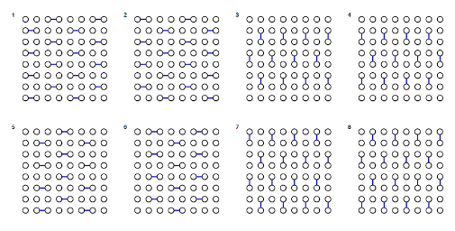
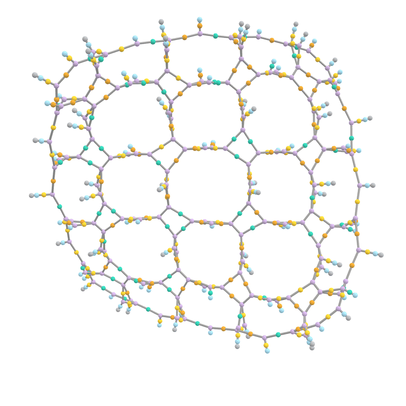
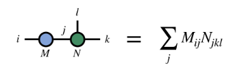
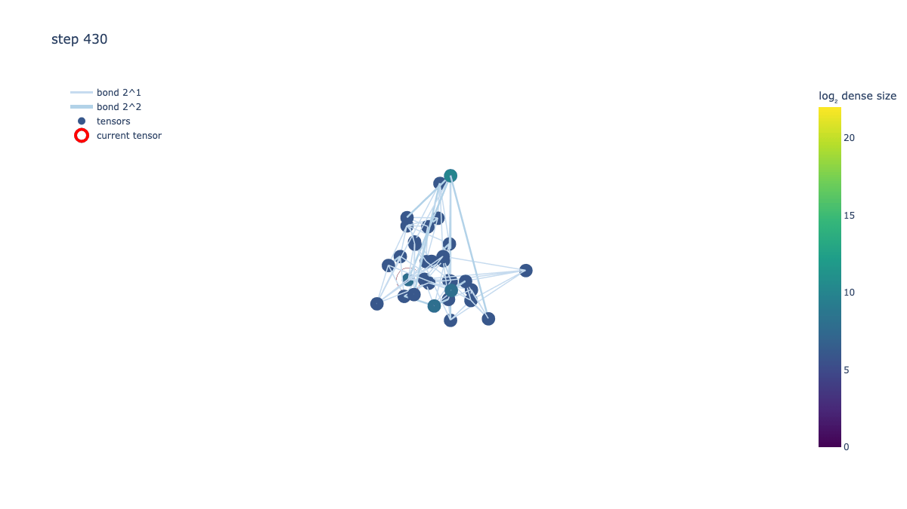
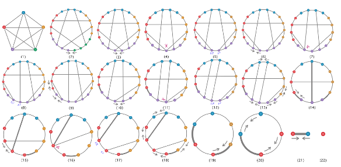
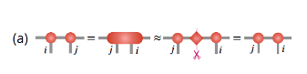
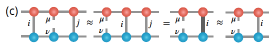
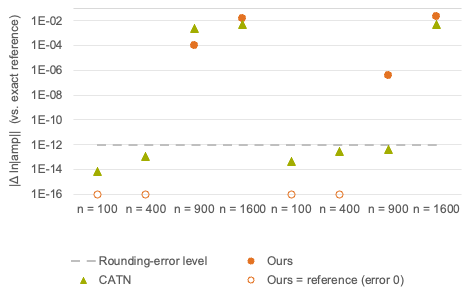
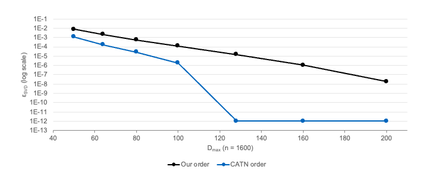

# Seminar – Advanced Topics of Quantum Computing

## Tensor Network Contraction

### Approximate algorithm for random quantum circuits via Contraction

This repository contains an implementation of the approximate tensor network contraction
algorithm for random quantum circuits, based on the paper *Contracting Arbitrary Tensor Networks: General
Approximate Algorithm and Applications in Graphical Models and Quantum Circuit Simulations* [[1]](#ref1).

## Repository structure

| Path                                  | Content                                                                                  |
|---------------------------------------|------------------------------------------------------------------------------------------|
| `main.py`                             | Prototype: the MPS calculus kernel as presented in the talk                                      |
| `main_heap.py`                        | Same algorithm with a heap for edge selection; used for the large runs (n = 900, 1600) because it is much faster          |
| `TensorPrimitive/`                    | Circuit construction (`circuits.py`) and circuit → tensor network mapping (`network.py`) |
| `example_circuit.py`                  | Minimal example: amplitude ⟨0…0\|C\|0…0⟩ of one random circuit                            |
| `legacy/Test/`                        | Scripts that produce the results |
| `Data/`                               | Raw outputs of these scripts (logs, CSV, recorded CATN orders)                           |
| `figure/`                             | Figures used in this README                                                              |
| `legacy/` (everything except `Test/`) | Older versions and experiments, **not part of the submission**                           |

## Run

```bash
pip install -r requirements.txt
python example_circuit.py            # L = 10 (n = 100), d = 8
python example_circuit.py 30 8       # n = 900
python main.py
```

Expected output of the first command (exact contraction, no truncation):

```text
n = 100, depth = 8, D_max = 50, chi_max = 500
ln|amp| = −35.0669102715   eps_SVD = 1.20e-29
```

## AI declaration

| Part                               | Where                  | AI usage    |
|------------------------------------|------------------------|-------------|
| `safeSVD` (gesdd → gesvd fallback) | `main_heap.py/main.py` | AI-assisted |
| QR step of `cutBond`               | `main_heap.py`         | AI-assisted |
| `popBestEdge`                      | `main_heap.py`         | AI-assisted |
| FIFO tie-break variant             | `main_heap.py`         | AI-assisted |
| Test and benchmark scripts         | `legacy/Test/`         | AI-assisted |

All other parts of the kernel, the circuit construction and the analysis are my own work.

### Circuit Generation

The circuits generated in this code follow Google's quantum supremacy experiments [[5]](#ref5).
Each circuit has the structure: Hadamard (H) layer → CZ layers → Hadamard (H) layer.
The CZ gates are applied in the eight layout patterns shown in Figure 1.

<p align="center">
  
</p>

*Figure 1: The eight CZ-gate layout patterns used for circuit generation [[1]](#ref1).*

Figure 2 shows the tensor network produced by our circuit generation procedure. Its key property is
high entanglement, which makes the circuit hard to simulate on classical computers. Single-qubit gates
are drawn from the set {T, X<sup>1/2</sup>, Y<sup>1/2</sup>}.

<p align="center">
  
</p>

*Figure 2: Tensor network of a generated circuit with L = 10 (10 × 10 qubits) and depth d = 8.*

Table 1 lists the gate content of this circuit layer by layer and tracks how the entanglement builds up.
Together with the two H layers (200 gates), the circuit has 684 gates. Its tensor network has 884 tensors and 964 bonds.

| Layer | CZ pattern | Dir. | CZ gates | Single-qubit gates | CZ across middle cut (cum.) | Light cone of centre qubit |
|:-----:|:----------:|:----:|---------:|-------------------:|----------------------------:|---------------------------:|
| 1     | 1          | ↔    | 25       | 50                 | 5                           | 2 / 100                    |
| 2     | 2          | ↔    | 25       | 50                 | 10                          | 2 / 100                    |
| 3     | 3          | ↕    | 20       | 30                 | 10                          | 3 / 100                    |
| 4     | 4          | ↕    | 20       | 40                 | 10                          | 4 / 100                    |
| 5     | 5          | ↔    | 20       | 24                 | 10                          | 6 / 100                    |
| 6     | 6          | ↔    | 20       | 40                 | 10                          | 8 / 100                    |
| 7     | 7          | ↕    | 25       | 20                 | 10                          | 12 / 100                   |
| 8     | 8          | ↕    | 25       | 50                 | 10                          | 16 / 100                   |
| **Σ** |            |      | **180**  | **304**            | **10**                      |                            |

*Table 1: CZ layers and gate counts of the circuit in Figure 2 (L = 10, d = 8, seed = 0).*

* **Cut bound:** each CZ across a cut adds at most one ebit, so the entanglement between the left and the
  right half is at most $S \leq \min(10, n/2) = 10$ ebits. An exact MPS across this cut therefore needs a
  bond dimension of at most $2^{10}$.

* **Light cone:** after d = 8 layers, the centre qubit influences 16 of the 100 qubits (13 % on average).

* **Treewidth:** a min-degree heuristic gives an upper bound of 9, so contraction costs $2^{\mathcal{O}(9)}$.

At d = 8 the entanglement is therefore still far from its maximum of 50 ebits. This is why the n = 100 circuit
can still be contracted exactly (Figure 8). The entanglement keeps growing with the depth d and the
system size n, and the exact contraction cost grows exponentially with it.

### Tensor Contraction

A quantum circuit can be simulated by mapping it to a tensor network and contracting it.
Contracting two tensors means multiplying them and summing over their shared index.
Figure 3 shows this operation in tensor diagram notation.

<p align="center">
  
</p>

*Figure 3: Contraction of two tensors over a shared index, in tensor diagram notation [[7]](#ref7).*

As the contraction proceeds, the intermediate tensors grow until further contractions become too expensive.
Figure 4 shows that even for a small circuit (n = 36 qubits), the tensors grow exponentially
because of the high entanglement. Without the MPS representation, the largest intermediate tensor
has 2<sup>22</sup> elements. With the MPS representation, the largest bond dimension is 2<sup>11</sup>,
without any truncation. The reduction comes only from how the data is stored and processed, not from an approximation.

<p align="center">
  
</p>

*Figure 4: Growth of the tensors during the contraction of an n = 36 qubit circuit.*

Figure 5 illustrates the swap, contract and merge operations on a small five-tensor network after it
has been converted to the MPS representation.

<p align="center">
  
</p>

*Figure 5: MPS calculus steps (conversion to MPS form, select, swap, contract, merge) for a five-tensor network.*

### Sources of truncation error

Only two operations introduce an error during the contraction: truncating the virtual bond
to $\chi_{\max}$ during **swaps**, and truncating the physical bond to $D_{\max}$ during **merges**.

#### Swap → virtual bond $\chi$

* **What:** Moving an index one place along the MPS contracts two neighboring tensors and splits them again by SVD.
* **Grows:** Each swap can enlarge the virtual bond $\chi$ between the two tensors (it can also shrink or stay the same).
* **Cut:** If $\chi > \chi_{\max}$, only the $\chi_{\max}$ largest singular values are kept (Eckart–Young theorem).
  The discarded part adds to $\varepsilon_{\mathrm{swap}}$.

<p align="center">
  
</p>

*Figure 6: Swapping two neighbouring MPS tensors: contraction, SVD, and truncation of the virtual bond.*

#### Merge → physical bond $D$

* **What:** After a contraction, two parallel edges to the same tensor fuse into one index.
* **Grows:** The fused index has dimension $d_a \cdot d_b$.
* **Cut:** If $d_a \cdot d_b > D_{\max}$, the MPS is canonicalized and the bond is SVD-truncated to $D_{\max}$.
  The discarded part adds to $\varepsilon_{\mathrm{merge}}$.

<p align="center">
  
</p>

*Figure 7: Merging two parallel edges into one physical bond, followed by truncation to $D_{\max}$.*

**Everything else is lossless.** The accumulated truncation error is:

$$
\varepsilon_{\mathrm{SVD}} = \varepsilon_{\mathrm{swap}} + \varepsilon_{\mathrm{merge}}
$$

This sum is accumulated over the whole tensor network and returned as the second output of the MPS calculus kernel.

### Comparison with CATN

#### Experimental setup

| Parameter                       | Value                                                                    |
|---------------------------------|--------------------------------------------------------------------------|
| Hardware                        | Apple M4 MacBook Air, 16 GB RAM                                          |
| Reference code                  | CATN (Pan et al.) [[2]](#ref2)                                           |
| Circuits                        | Pan et al. protocol, L × L qubits, d = 8, single amplitude ⟨0…0\|C\|0…0⟩ |
| D<sub>max</sub> (physical bond) | 50                                                                       |
| χ<sub>max</sub> (virtual bond)  | 500                                                                      |
| Contraction order               | Greedy                                                                   |

*Table 2: Experimental setup for the simulations.*

#### Validation of the kernel

* **State vector:** for n ≤ 25 (L = 3, 4, 5; d = 6 … 16) the amplitude agrees with an exact state-vector
  simulation to a relative error of at most **4.1e-14**.
* **Replay of CATN's order:** at n = 900 (authors' circuit files), our kernel run with CATN's recorded
  contraction order agrees with CATN's amplitude to **1.7e-13**.

#### Results and Discussion

The code is written in Python and compared against the reference implementation CATN.
As Figure 8 shows, the exact solution is obtained for small qubit counts such as *n = 100* and *n = 400*.
The comparison is done both on our circuits and on the authors' published circuit files.
The y-axis shows the true error, computed against the exact reference value of each configuration.

For *n = 900* and *n = 1600* there is no clear winner. We analyzed the difference at n = 900 on the authors'
circuit files and found no problem in our kernel (see the replay above). In our view, the main difference
is the tie-break rule: when several edges have the same cost, CATN selects the *oldest* edge, while our
implementation prefers the edge that closes the most triangles and then the smallest index. Both implementations use the same greedy criterion.

<p align="center">
  
</p>

*Figure 8: True error of our implementation vs. CATN for different system sizes. Left: our circuits; right: the authors' circuit files.*

#### Reported ε vs. true error

The reported truncation error $\varepsilon_{\mathrm{SVD}}$ is an **indicator, not a bound**:

* **Squared vs. linear:** $\varepsilon$ is a $\sigma^2$ weight, while the amplitude is linear in the tensors, so the amplitude error scales like $\sqrt{\varepsilon}$.
* **Local vs. global:** each cut is optimal for the MPS of one tensor (see [Sources of truncation error](#sources-of-truncation-error)), not for the final amplitude.
* **Sum:** errors from different cuts can amplify or cancel each other. $\varepsilon$ only adds up the discarded weights.

| Circuits       |    n | Reported ε | True error | **True / ε** | True / √ε |
|----------------|-----:|-----------:|-----------:|-------------:|----------:|
| Ours           |  900 |     3.1e-7 |     1.1e-4 |      **370** |      0.20 |
| Ours           | 1600 |     6.3e-2 |     1.5e-2 |     **0.24** |      0.06 |
| Authors' files |  900 |    7.7e-10 |     4.1e-7 |      **530** |     0.015 |
| Authors' files | 1600 |     7.6e-3 |     2.4e-2 |      **3.1** |      0.27 |

*Table 3: Reported truncation error vs. true error.*
ε is the share of the $\sigma^2$ weight discarded at each cut, summed over all cuts. The true error is the deviation of the final amplitude from the reference.
$D_{\max} = 50$, $\chi_{\max} = 500$, our kernel.

**True / ε** ranges from 0.24 to 530. That is more than three orders of magnitude, and wrong in both directions.
**True / √ε** stays between 0.015 and 0.27, so it is below 1 on all four circuits. This is measured, not guaranteed.

### Greedy contraction criterion

The greedy criterion is a simple heuristic that picks the cheapest edge to contract next:

$$
\mathrm{cost}(\mu, \nu) = \log \mathrm{Size}(\mu) + \log \mathrm{Size}(\nu) - 2 \log D_{\mu\nu}
$$

This is the logarithm of the size of the merged tensor.
**Greedy rule:** at each step, contract the edge with the smallest cost.

### Effect of the contraction order

Figure 9 compares the two contraction orders directly by running both with our kernel.

<p align="center">
  
</p>

*Figure 9: Error vs. physical bond dimension cap $D_{\max}$ for CATN's contraction order and our contraction order, both run with our kernel.*

With CATN's order, the solution becomes exact once $D_{\max} \geq 128$. With our order, it is still not
exact at $D_{\max} = 200$. Both runs use our kernel, so this analysis isolates the **contraction order**
as the source of the difference, not the kernel. It does not isolate which part of the order causes it.
The tie-break rule is the most likely candidate, since both codes use the same greedy criterion.

## References

<a id="ref1"></a>[1] F. Pan, P. Zhou, S. Li, and P. Zhang, "Contracting arbitrary tensor networks: General approximate algorithm and applications in graphical models and quantum circuit simulations," *Phys. Rev. Lett.*, vol. 125, 060503, 2020. [arXiv:1912.03014v2](https://arxiv.org/abs/1912.03014v2)

<a id="ref2"></a>[2] F. Pan, "catn," GitHub repository. [Online]. Available: <https://github.com/panzhang83/catn>

<a id="ref3"></a>[3] "Tensor-Network-Contraction," GitHub repository. [Online]. Available: <https://github.com/Edizhanssy/Tensor-Network-Contraction>

<a id="ref4"></a>[4] ITensor, "MPS and MPO examples," ITensorMPS.jl documentation. [Online]. Available: <https://docs.itensor.org/ITensorMPS/stable/examples/MPSandMPO.html>

<a id="ref5"></a>[5] S. Boixo et al., "Characterizing quantum supremacy in near-term devices," *Nature Physics*, vol. 14, pp. 595–600, 2018. [arXiv:1608.00263](https://arxiv.org/abs/1608.00263)

<a id="ref6"></a>[6] R. Orús, "A practical introduction to tensor networks: Matrix product states and projected entangled pair states," *Ann. Phys.*, vol. 349, pp. 117–158, 2014. [doi:10.1016/j.aop.2014.06.013](https://doi.org/10.1016/j.aop.2014.06.013)

<a id="ref7"></a>[7] "Tensor diagram notation," TensorNetwork.org. [Online]. Available: <https://tensornetwork.org/diagrams/>

<a id="ref8"></a>[8] I. L. Markov and Y. Shi, "Simulating quantum computation by contracting tensor networks," *SIAM J. Comput.*, vol. 38, no. 3, pp. 963–981, 2008. [doi:10.1137/050644756](https://doi.org/10.1137/050644756)